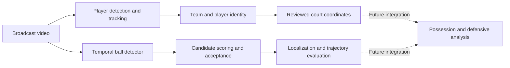

# Player Defense Score

**From broadcast basketball video to explainable defensive analysis.**

Player Defense Score is a computer-vision research and engineering project building the tracking foundation for possession-level basketball analysis. It combines player detection, identity reconciliation and court geometry with a ball-localization research pipeline that measures both correct detections and costly mistakes.

**Current status:** the reviewed player-coordinate pipeline works across curated possessions. NBA ball tracking is under active evaluation. A complete automatic tracker and defensive scoring model have not yet passed validation.

[Project and architecture overview](docs/project_overview.md) · [Ball-tracking results](docs/ball_tracking_results_overview.md) · [Run the public tests](#try-the-code)

## Selected results

| Milestone | Measured result | What it establishes |
|---|---|---|
| Configuration-driven player pipeline | All **21 stages** completed on possession 003; **4,921/5,000 player-frame coordinates (98.42%)** | Coordinate coverage on one reviewed possession; coverage is not localization accuracy |
| Candidate acceptance study | **266 more correct acceptances**, **65 fewer wrong outputs**, **20 fewer hidden-ball emissions** than the original quality filter | An improved acceptance rule on identical candidate choices across 2,811 eligible NBA frames; remaining quality gates fail |
| Fresh-game diagnostic | Native detector: **298/310 correct locations (96.13%)**; acceptance retained all 298 while reducing wrong outputs from 6 to 4 | Three short windows from one NBA game; two hidden-ball emissions remain |
| Controlled wider-context experiment | Correct-first candidate ranking improved from **90.43% to 92.81%** | Better ranking, but preservation/acceptance gates failed; the model was not adopted |

These are different evaluation populations, not a single project accuracy score. The NBA scorer folds exclude games from scorer fitting, but the detector had already seen those games. The fresh-game diagnostic is now exposed development evidence. **The overall 95% tracking goal has not been met.** See the [results overview](docs/ball_tracking_results_overview.md) for denominators, controls and limitations.

## How it works



The player branch uses RF-DETR detection, ByteTrack tracking, OSNet-AIN appearance features and reviewed court calibration. The ball branch uses a specialized temporal detector, DINOv2-based candidate features and separate acceptance experiments. Missing or uncertain observations remain explicit; successful reference annotations do not automatically certify new model predictions.

The project builds on existing vision models. Its engineering contribution is the basketball-specific pipeline, supervision, experiment design, failure analysis and evidence needed to decide whether a change actually helps.

## Engineering highlights

- **Resumable orchestration:** possession-scoped configurations, stage planning and explicit identity/calibration review gates.
- **Failure-driven research:** distinguish missing proposals, incorrect ranking, harmful rejection and hidden-ball emissions before choosing an intervention.
- **Regression-aware evaluation:** compare exact gained/lost detections as well as aggregate scores, with separate source roles and uncertain references.
- **Recoverable training:** preserve completed work, restore optimizer/random state and report replayed work separately after interruptions.
- **Auditable decisions:** retain failed experiments, protocols, machine-readable review records and focused tests alongside successful results.

## Try the code

The portable checks require **Python 3.11 or newer** and no third-party packages, footage, weights or GPU. From a fresh clone:

```bash
git clone https://github.com/ryanrathbun6163/player-defense-score.git
cd player-defense-score
python tools/test_public.py
```

The explicit public subset contains **165 tests** covering pipeline planning, annotation and point-evaluation contracts, failure-study joins, acceptance metrics, transfer analysis and experiment accounting. The runner disables site-packages and fails on missing tests or skips. [GitHub Actions](https://github.com/ryanrathbun6163/player-defense-score/actions/workflows/public-tests.yml) runs the same checks on Python 3.12.

Inspect a configuration-driven plan without executing a model or writing pipeline outputs:

```bash
python -B -m src.pipeline.run_player_coordinates --config configs/possession_003_pipeline.json --gate-evidence configs/possession_003_generalization_evidence.json --dry-run
```

This reads a committed record of the reviewed milestone; it does not reproduce or independently revalidate that experiment. The [pipeline guide](docs/pipeline_generalization.md) explains execution and resumption when the required inputs are available.

### Full research environment

The source repository includes code, configurations, reference/review records, tests and reports. Raw broadcast footage, generated media, prediction arrays, model weights and machine-local execution receipts remain outside Git. Some historical report links therefore refer to local evidence unavailable in a public clone.

The [requirements file](requirements.txt) records the working environment, including CUDA-specific PyTorch packages; it is not a universal installation lockfile. Full inference and research replay need compatible dependencies, permitted source footage, checkpoints and the relevant bound artifacts. The complete `unittest` discovery suite includes those local integration tests; use the explicit public runner for a clean clone.

Historical experiment launchers intentionally validate their original Git/runtime/input identities. A new experiment requires a new reviewed configuration; publishing this source does not authorize or silently reproduce past GPU workloads.

## Explore the repository

| Area | Start here |
|---|---|
| Architecture and engineering narrative | [Project overview](docs/project_overview.md) |
| Results, controls and research lessons | [Ball-tracking results overview](docs/ball_tracking_results_overview.md) |
| Player pipeline | [Runner](src/pipeline/run_player_coordinates.py), [planner](src/pipeline/planner.py), [generalization guide](docs/pipeline_generalization.md) |
| Ball failure decomposition | [Saved-score study](docs/ball_tracking_saved_score_failure_study_results.md), [analysis code](src/ball_tracking/saved_score_failure_analysis.py) |
| Candidate acceptance | [Experiment results](docs/ball_tracking_candidate_acceptance_gate_results.md), [evaluation code](src/ball_tracking/candidate_acceptance_evaluation.py) |
| Controlled context experiment | [Protocol](docs/ball_tracking_dual_view_context_protocol.md), [model](src/ball_tracking/dual_view_context_model.py), [results](docs/ball_tracking_dual_view_context_results.md) |
| Portable checks | [Public test runner](tools/test_public.py), [tests](tests) |
| Detailed research history | [Context index](docs/context/README.md), [archived README](docs/history/README_before_publication_2026-10-30.md) |

The archived README preserves the previous chronological record verbatim; its relative links retain their original repository-root context. The current overview is the entry point for the latest status.

## Next milestones

1. Establish additional permitted NBA sources, with actual current-detector failures, correct controls and separate evaluation roles.
2. Use that evidence to choose one bounded intervention at the failing layer: candidate generation, selection or acceptance.
3. Validate a complete ball method against correct-location, wrong-output, hidden-emission, continuity, recovery and human-review requirements together.
4. Extend reviewed identity and geometry to NBA footage, then develop possession events, defensive matchups and a separately validated scoring model.

The acceptance target includes at least **95% correct eligible locations within 10 source pixels**, at most **1% wrong eligible outputs**, **zero certain-hidden emissions**, and temporal/review requirements. Aggregate improvements alone do not qualify a tracker for adoption.

## Attribution and data

This project incorporates third-party models and libraries; their licenses and notices apply to their respective components. Source footage is not redistributed here. References and implementation details are recorded in the [research notes](docs/research/ball_tracking_research.md), model-specific reports and included third-party notices. No project-wide license grant is currently included.
