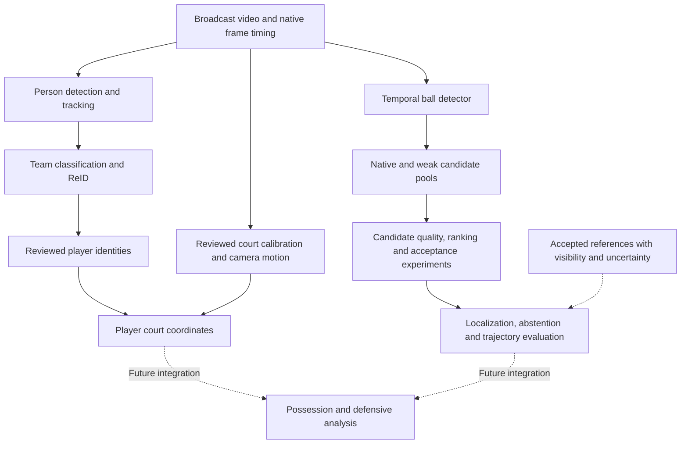

# Player Defense Score: project overview

Player Defense Score is a computer-vision research project working toward explainable, possession-level basketball defensive analysis from broadcast video. The central challenge is turning uncertain visual observations into measurements that can support a defensible basketball conclusion.

The repository currently contains a reviewed player-coordinate pipeline and an active ball-localization research program. Automatic NBA ball tracking has not passed the complete acceptance criteria. Possession understanding, matchup attribution and the defensive-value model remain future work.

## System architecture



The player pipeline combines detection/tracking, jersey-color evidence, appearance embeddings, reviewed identity reconciliation and court-coordinate transforms. The ball branch separates **whether a useful proposal exists**, **which point scores highest**, and **whether to emit or abstain**. Reference annotations supervise and evaluate experiments; they are not available to an automatic selector at inference.

## Demonstrated engineering milestone

A configuration-driven workflow completed all **21 stages** on possession 003 without possession-specific source edits. Its reviewed evidence records:

| Measure | Result |
|---|---:|
| Frames with a camera homography | 500/500 |
| Player-frame coordinate coverage | 4,921/5,000 — 98.42% |
| Frames containing all ten player coordinates | 431/500 — 86.20% |
| Unresolved identity/calibration reviews and coordinate-key violations | 0 |

Coordinate coverage measures completeness, not pointwise localization accuracy. This result establishes a curated multi-possession foundation; it does not certify NBA roster identity or moving-camera geometry across full games. See [pipeline generalization](pipeline_generalization.md) and the [reviewed evidence](../configs/possession_003_generalization_evidence.json).

## Research contributions

- **Failure decomposition:** saved predictions distinguish missing proposals, incorrect ranking, harmful rejection and hidden-ball emissions. Each failure suggests a different intervention.
- **Controlled learning experiments:** a learned candidate-quality score and a separate acceptance model are compared on identical candidate identities. A later context experiment controls extra capacity with a duplicate-local arm.
- **Preservation-aware evaluation:** per-game checks and exact success identities prevent aggregate improvements from concealing regressions. Unknown references remain unknown.
- **Reproducible execution:** manifests bind sources, configurations and checkpoints; stage state supports resumption; focused tests and independent output checks validate transport and measurements.
- **Recoverable experiments:** completed captures and fits are reused after interruption. Checkpoint restoration includes optimizer and random state, and replayed computation is reported separately from the intended algorithmic workload.

The [ball-tracking results overview](ball_tracking_results_overview.md) explains the measured improvements and failed gates. Successful components and rejected recipes are both retained as evidence.

## Code tour

| Area | Starting point |
|---|---|
| Config-driven orchestration | [player-coordinate runner](../src/pipeline/run_player_coordinates.py), [stage planner](../src/pipeline/planner.py) |
| Identity and geometry | [identity construction](../src/identity/build_player_identities.py), [court-coordinate export](../src/court/export_player_court_coordinates.py) |
| Candidate evaluation | [fixed-choice acceptance metrics](../src/ball_tracking/candidate_acceptance_evaluation.py) |
| Controlled context model | [dual-view model](../src/ball_tracking/dual_view_context_model.py), [frozen protocol](ball_tracking_dual_view_context_protocol.md) |
| Complete result analysis | [recovered-run analysis](../src/ball_tracking/dual_view_context_recovery_analysis.py), [results](ball_tracking_dual_view_context_results.md) |

The implementation uses Python, PyTorch, OpenCV, NumPy and configuration-driven command-line tools. The research incorporates existing detector and representation models; the project contribution is their basketball-specific integration, supervision, controlled comparison and evaluation.

## Reproduction and data availability

Code, configuration records, focused tests and written findings are versioned. Broadcast footage, generated videos, large prediction arrays and model artifacts are not distributed as part of this source repository. A fresh clone therefore supports code inspection and self-contained tests, but does not reproduce every reported experiment without the corresponding permitted footage, accepted references, checkpoints and bound local artifacts.

For a small CPU-only example, run from the repository root:

```bash
python -m unittest discover -s tests -p "test_candidate_acceptance_evaluation.py"
```

These synthetic tests exercise acceptance and evaluation rules without downloading weights or processing footage. The [pipeline guide](pipeline_generalization.md) documents configuration, dry runs, resumption and explicit identity/calibration review gates for users with the required inputs. The [requirements file](../requirements.txt) records the working environment; GPU inference and full experiment replay have additional model/data prerequisites.

## Remaining work

The immediate research priority is diverse, permitted examples of actual current-detector failures, successful controls and separate evaluation sources. A useful candidate or an impressive fitting result is insufficient: the final ball method must satisfy localization, wrong-output, hidden-emission, continuity, recovery and visual-review requirements together. Defensive scoring then requires its own attribution definitions and accepted evaluation examples; a coordinate track alone does not measure defensive value.
