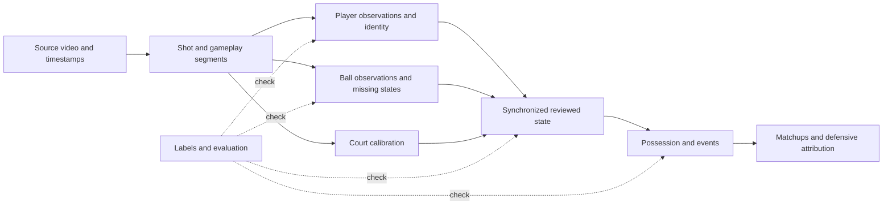

# Sports video tracking research for Player Defense Score

**October 18 footage-access investigation:** start with [NBA footage access](nba_footage_access.md) for the current acquisition priority. This new collection contains a decision report, three detailed chapters and a [134-record source ledger](nba_footage_access_sources.json) covering 156 distinct source URLs. The exact February 23 Spurs–Pistons source has eight decoded 1080p/59.94 fps samples; a full local game and continuous coverage are not yet verified. A complete small BARD NBA clip was acquired. The report also resolves the original NFHS source through the migration archive and records alternative full-game routes, failed checks and the next concrete acquisition step.

The October 8 research below remains historical rationale. Its recommended WASB work and subsequent motion comparison have already been performed; do not repeat them merely to resume. The [current state](../context/current_state.md) and completed local results take precedence.

Research date: **2026-10-08**. Start with [the implementation recommendations](recommendations.md), then use the detailed chapters and source ledgers below. This collection records researched evidence and engineering judgments. No external model was run or promoted by this research.

**Subsequent local evidence:** the [WASB transfer comparison](../ball_wasb_transfer_results.md) has now run successfully on the six development windows. At its published heatmap threshold it is too sparse to replace RF. The research below remains the pre-experiment rationale; use the local result when making the next choice.

The original October 8 collection contains **eight narrative documents and four source ledgers**, with **269 source records covering 265 distinct URLs**. Records include papers, implementation files, benchmark documentation and artifact terms; these are not 269 reproduced studies. Inspection depth and unresolved questions are recorded beside the sources. The separate October 18 footage collection is counted above.

## The practical conclusion

Our next ball experiment should test a **basketball-specific temporal image model**, with WASB the leading candidate from this review. It can learn visual motion across frames, adding information beyond the generic detector boxes and hand-built association rules already explored. Its published basketball checkpoint link makes it a concrete candidate; binary download/access, local performance and integration remain unverified.

Keep the reviewed player-coordinate foundation and saved RF-DETR outputs. Use SoccerNet/TrackLab and basketball projects as implementation references, not as a reason to rewrite the entire system. Build toward one usable synchronized player/ball result, then possession and matchup understanding, then transparent defensive attribution.

## Where the project stands

| Area | Current status | What the research changes |
| --- | --- | --- |
| Player coordinates | Completed for three curated possessions; P003 empirical gate passed | A broader reference library for future identity/geometry work |
| Generic detector comparison | Completed; tested YOLO agreement rule worsened all six windows | Stop that rule; compare genuinely different ball evidence |
| Ball trajectories | No production method/operating point/quality gate selected | A justified shortlist and concrete evaluation/adapter design |
| Possession, identity, matchups, defense | Not complete | Clarifies dependencies, reusable components and limits of common shortcuts |
| Full-game/cross-game validation | Not complete | Separates curated success from broader claims |

The recovered detector result remains a negative result from a failed-publication attempt. This research does not change its historical status, consumed resources, reviews or holdouts. See [the result report](../ball_crop_cross_detector_corroboration_results.md).

## Reading map

| Document | What it helps decide |
| --- | --- |
| [Recommendations](recommendations.md) | What to do next, what to reuse, what to defer, and what would change the decision |
| [Ball tracking](ball_tracking_research.md) | TrackNet/WASB, newer ball methods, basketball data, temporal/visibility assumptions and exact implementation hazards |
| [Player tracking and geometry](player_tracking_and_geometry.md) | ByteTrack alternatives, learned association, ReID/OCR, sports datasets, segmentation/point trackers and court geometry |
| [Complete projects and analytics](sports_projects_and_analytics.md) | Source-inspected pipelines, basketball prototypes, open data, events, value models and commercial scope |
| [Detectors and model selection](detectors_and_model_selection.md) | RF/YOLO context, specialist alternatives, slicing, open-vocabulary models and fine-tuning choices |
| [Evaluation, data and pipeline design](evaluation_data_and_pipeline_design.md) | Useful metrics, labels/splits, abstention, caching, dependency isolation and proportionate validation |
| [Research method and gaps](research_method_and_gaps.md) | What was inspected, what was not reproduced, and which uncertainties remain |

Machine-readable source ledgers: [ball](ball_tracking_sources.json), [players/geometry](player_tracking_sources.json), [projects/analytics](sports_projects_sources.json), [evaluation/detectors](evaluation_and_detector_sources.json). Each records inspection depth and caveats; source entries are not a count of reproduced systems.

## How the pieces fit

The drawing describes a measurement pipeline, not a claim that every box is complete. Court calibration maps appropriate ground-plane points; it does not automatically supply the height or court position of an airborne ball. Inferred states stay distinguishable from observations.

## Working vocabulary

| Term | Plain meaning |
| --- | --- |
| Detection | Finding a possible object in one image |
| Heatmap | An image-sized map whose high values indicate likely ball locations |
| Association | Deciding which observations across frames belong to the same object |
| Re-identification | Comparing appearance to reconnect a person after separation or occlusion |
| Temporal model | A model that uses multiple frames, with past/future context explicitly specified |
| Occlusion | The target is hidden behind something; it is different from leaving the image |
| Abstention | Withholding an unreliable observation instead of forcing a guess |
| Calibration | Either image-to-court geometry or confidence-to-frequency calibration; these are different tasks |
| Fine-tuning | Adapting pretrained model parameters using relevant labeled examples |
| Holdout | Data reserved to judge a choice after development, rather than tune it |
| Reproduction | Actually running the released method under a stated evaluation protocol |

The studies and repositories are dated evidence. Future work should use these notes to make a narrow decision, record its local result, and integrate a useful increment—not restart the entire survey or test suite.
